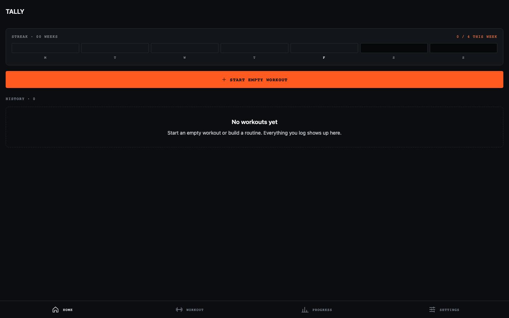
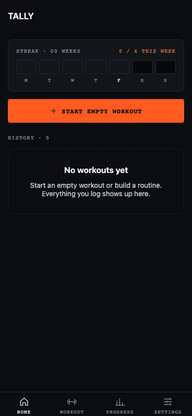
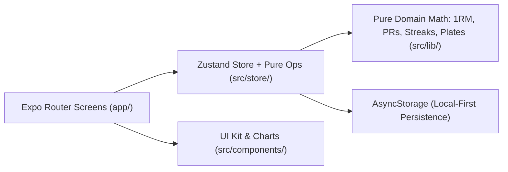

# Tally — workout tracker (Expo / React Native)

[](https://github.com/vikramwish/tally/actions/workflows/ci.yml)
[](https://github.com/vikramwish/tally/actions/workflows/pages.yml)
[](tsconfig.json)
[](LICENSE)

> **Live Web Demo:** [vikramwish.github.io/tally](https://vikramwish.github.io/tally/)

Core logging plus progress and PRs, built from the Tally design canvas
(Paradion dark theme: Ink & Paper, one Ember accent, mono labels).
All data stays on the phone or browser (`AsyncStorage`). No account or server.

<table>
  <tr>
    <td></td>
    <td></td>
  </tr>
</table>

## Run it

```bash
npm ci
npx expo start           # scan the QR code with Expo Go, or press i / a / w
```

Static web bundle verification and pure logic tests (1RM, PRs, plates, warm-ups, streaks, muscle sets, workout ops, web bundle config):

```bash
npm run typecheck
npm test
npx expo export --platform web --output-dir dist --clear
node scripts/verify-web-export.mjs dist
```

> Package versions are pinned to Expo SDK 53. If you're on a newer SDK,
> `npx expo install --fix` updates them. The rest-timer notification works in
> Expo Go on iOS; on Android it may need a development build
> (`npx expo run:android`).

## What works

**Logging**
- Start an empty workout or a routine; minimise it and resume from any tab.
- Sets with kg/lb, reps, or seconds depending on the exercise. Set types:
  normal, warm-up (W), drop (D), failure (F).
- "Previous" column from your last session (or the last time you did that
  routine — see Settings). Tap it to copy; ticking an empty set fills it from
  previous automatically.
- RPE per set (6–10), notes per exercise, rest time per exercise.
- Rest timer starts when you tick a set: ±15s, skip, haptic at the end, and a
  local notification if the phone is locked. No rest between exercises in a
  superset; the round's rest runs after the last one.
- Supersets, reorder, remove, add exercises mid-workout.
- Live PR detection: PR sets are highlighted while you train.
- Plate calculator (your bar and plates, kg or lb) and a warm-up ramp you can
  insert as warm-up sets in one tap.
- Keep-screen-awake during workouts.
- Finish: title, notes, PR summary, optionally write today's numbers back into
  the routine. Unfinished sets are dropped.

**Routines & library**
- Routines with target sets/weights/reps, folders, duplicate, delete,
  save any past workout as a routine.
- ~50 built-in exercises plus custom exercises (equipment, primary and
  secondary muscles, and whether they track weight & reps, reps only, or time).

**Progress & PRs**
- Home: weekly streak, this week vs. your weekly goal, full history with PR counts.
- Workout detail with PR trophies, share as text, delete.
- Exercise page: chart of est. 1RM / heaviest / volume / reps per session,
  all-time records, best weight for at least N reps, session history.
- Progress tab: monthly report (step back through months), 12-week
  consistency grid, sets per muscle this week vs a 10–20 target band
  (secondary muscles count half), muscle distribution, recent PRs, most-done
  exercises, bodyweight chart.
- Body measurements: weight, body fat, waist, chest, arm, thigh, with charts.
- Settings: units, rest defaults, haptics/notification, previous-values
  source, RPE, keep awake, weekly goal, bar and plates, JSON export, reset.

PRs only count from your **second** session of an exercise, so the first
time you log something isn't flagged as a record. Est. 1RM uses Epley.

## Not built yet (from the design)

- Social: feed, profiles, follow, leaderboards, compare. These need a backend
  and accounts.
- Coach: assigned workouts and chat. Also needs a backend.
- Progress photos (would use `expo-image-picker`).
- Strava / Apple Health, home-screen widgets and Live Activities. These need
  native modules and a development build.
- Plan generator, and Geist fonts (the app uses system sans + Menlo /
  monospace; add `@expo-google-fonts/geist` if you want the exact type).

## Layout & Architecture



```
app/                    expo-router screens
  (tabs)/               Home, Workout, Progress, Settings
  workout/live.tsx      the live logger (full-screen modal)
  workout/finish.tsx    save sheet
  workout/plates.tsx    plate + warm-up calculator
  exercise/             picker, custom exercise, exercise detail
  routine/edit.tsx      routine editor
  history/[id].tsx      workout detail
  measurements.tsx
src/
  lib/                  pure logic: types, calc, stats, format, exercise library
  store/                zustand store (persisted) + pure ops on workouts/routines
  components/           UI kit, charts, number input, rest-timer watcher
  theme.ts              design tokens
scripts/
  verify-web-export.mjs validates static web bundle & guards against import.meta leaks
```

Weights are always stored in kilograms and converted for display.

## License

Released under the [MIT License](LICENSE).
